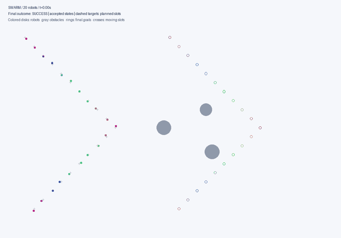
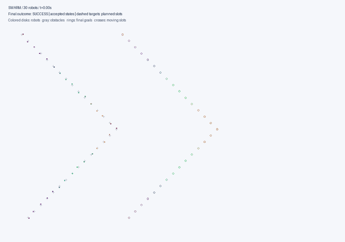
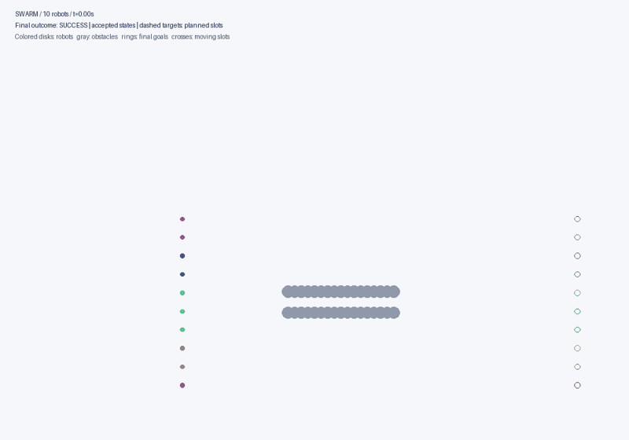
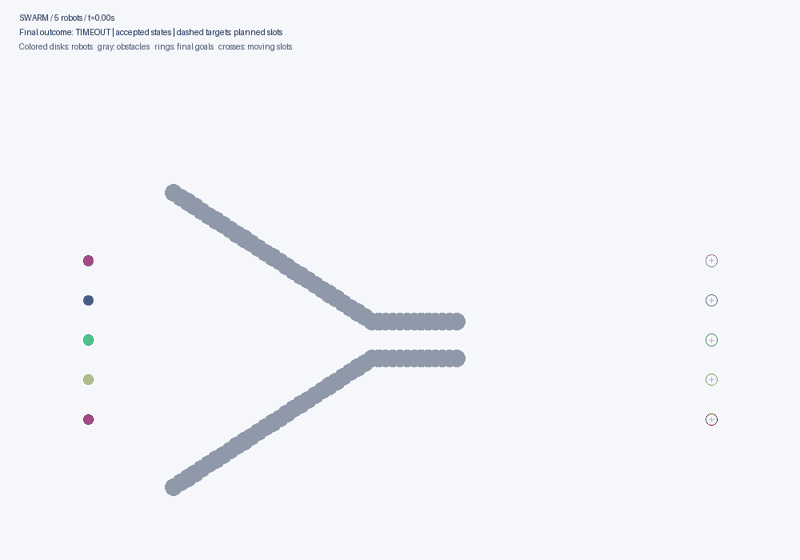

# Swarm APF — симулятор на Python

Собраны E0 (однороботный APF/vortex) и E1 (синхронный рой роботов-дисков).
В E1 доступны диагностический GoalController и экспериментальный Boids.
Добавлены A (локальный APF) и B (Formation APF), восстановленные по спецификациям.
C (фиксированная циркуляция) и D (адаптивные режимы) подключены к E1.
Экспериментальный runner E1 интегрирован. Сценарии E2 доступны через отдельный experiment_e2.

## Установка

Требуется Python 3.11 или новее.

```bash
python -m venv .venv
# Linux/macOS:
source .venv/bin/activate
# Windows PowerShell: .venv\Scripts\Activate.ps1
python -m pip install -e ".[dev]"
python -m pytest -q
```

## Рой E1

```bash
python -m swarm_apf.swarm_cli --robots 5 --out results/e1
python -m swarm_apf.swarm_cli --robots 10 --controller boids --out results/boids
python -m swarm_apf.swarm_cli --scenario obstacle --out results/collision
```

Параметры: 5–20 роботов, --max-steps (по умолчанию 600), --no-plot.
Экспорт: history.csv (только принятые состояния), summary.json (конфигурация,
контроллер, исходы и отклонённый шаг), trajectory.png.
Сценарий obstacle с GoalController специально заканчивается столкновением:
этот контроллер движется прямо к цели и не обходит препятствия.
Boids по умолчанию также не включает отталкивание от препятствий.
Статус эксперимента хранится в JSON; нормальный выход CLI не означает SUCCESS.

## APF A и формация B

```bash
python -m swarm_apf.swarm_cli --controller A --robots 5 --out results/a
python -m swarm_apf.swarm_cli --controller B --robots 5 --out results/b_line
python -m swarm_apf.swarm_cli --controller B --robots 10 --formation V --out results/b_v
python -m swarm_apf.swarm_cli --controller B --scenario obstacle --out results/b_obstacle
```

A использует индивидуальные конечные цели, радиальные отталкивания и
нормализацию суммарной силы. B отслеживает фиксированные слоты движущейся
опорной точки; line и V задают геометрию. Опорный план согласован до старта,
не зависит от текущих позиций роя и не обходит препятствия. Поэтому B требует
общего времени и reference, а не является автономным согласованием формации.
Условие SUCCESS проверяется по конечным индивидуальным слотам.

Версии A-RECONSTRUCTED-1.0.0 и B-FORMATION-RECONSTRUCTED-1.0.0 обозначают
новые реализации формул BASELINE_A/B, а не восстановление исходных файлов
побайтно. Старые lock-файлы отсутствуют; эквивалентность замороженным
историческим реализациям не подтверждена. summary.json содержит версии,
параметры и происхождение, для B — также план и раскладку ID.
CLI-сцены A и B имеют разные старты: это демонстрации, не сравнительный benchmark.

## Вихревой C и адаптивный D

```bash
python -m swarm_apf.swarm_cli --controller C --scenario obstacle --out results/c
python -m swarm_apf.swarm_cli --controller D --scenario obstacle --out results/d
python -m swarm_apf.swarm_cli --controller D --ablation no_vortex --out results/d_no_vortex
```

C/D перенесены из исходных файлов репозитория без изменения формул.
Каждому ID назначается отдельный контроллер. При успешном reset симулятора
память D очищается. Общий план и слоты предоставляет восстановленный B;
это происхождение явно записано в summary.json.

D переключает NORMAL/PASSAGE/RECOVERY по локальным зазорам и прогрессу.
Абляции: full, no_weight_adaptation, no_vortex, no_formation_restoration.
Ключ --ablation применяется только к D. Отталкивания не ослабляются;
адаптируются вес формации и циркуляция. Гарантий выхода из ловушек нет.

Дополнительно D сохраняет modes.csv: режим, причина переключения,
коэффициенты, зазоры, предложенная команда и accepted. Запись относится к
попытке команды; последняя попытка может быть отклонена физикой. При нуле
попыток файл содержит только заголовок. Метаданные сохраняют параметры
каждого контроллера, общий план и раскладку.

## Пакетные эксперименты E1

Быстрый проверочный прогон (папка назначения должна быть новой):

```bash
python -m swarm_apf.experiment_runner --allow-contract-proxies --scenarios free --robots 5 --seeds 0 --max-steps 400 --out results/benchmark_01
```

Все пять сцен, 5/10/20 роботов, по десять seed (600 запусков):

```bash
python -m swarm_apf.experiment_runner --allow-contract-proxies --out results/benchmark_full_01
```

Сцены E1: free, single_obstacle, symmetric_obstacles, open_corridor,
offset_cluster. Можно ограничить --algorithms C D, --scenarios, --robots,
--seeds и --max-steps. Для C/D флаг --allow-contract-proxies не требуется,
но восстановленное происхождение геометрии B всё равно сохраняется.

**Флаг --allow-contract-proxies явно разрешает восстановленные A/B.**
Без него runner отказывается запускать A/B даже при наличии модулей.
Это предварительные эксперименты, не результаты оригинальных замороженных
baseline. Флаг не заменяет их проверку по отсутствующим историческим lock-файлам.

Каждый метод получает одинаковые начальные позиции, конечные цели,
геометрию, физику и seed для данного случая; scene_hash проверяет их тождество.
Параметры методов фиксированы. Сохраняются:

- manifest.json: настройки, версии среды, хеши исходников, статус COMPLETE/IN_PROGRESS.
- scenes/: точная геометрия и хеш каждого случая.
- runs.csv, aggregate.csv и aggregate.json: исходы и агрегаты.
- runs/: история, summary.json, ошибки формации, тайминги, метрики роботов,
  коллизии, отклонённые шаги; для D — mode_log.csv.

TIMEOUT учитывается отдельно, время завершения определено только при SUCCESS.
Метрики зазора включают отклонённый шаг. Тайминги не воспроизводятся побайтно;
траектории при одинаковых исходниках и условиях воспроизводятся.
--expect-code-sha позволяет проверить сводный хеш исходников перед запуском.
Существующие результаты не перезаписываются. IN_PROGRESS означает незавершённый
набор. Физическая допустимость стартов/целей проверяется до начала пакета;
геометрическую достижимость пути E1 не доказывает.

## Сценарии E2 — отдельная реконструированная версия

```bash
python -m swarm_apf.experiment_e2 --preflight-only --out results/e2_audit
python -m swarm_apf.experiment_e2 --allow-contract-proxies --scenarios free --robots 5 --seeds 0 --out results/e2_quick
python -m swarm_apf.experiment_e2 --scenarios blocked_room --stress-only --preflight-only --out results/e2_stress_audit
```

Основные карты: free, single_obstacle, obstacle_cluster, narrow_corridor,
u_trap, room_exit. Дополнительная two_obstacles пишется в diagnostic_*;
blocked_room требует --stress-only и пишет stress_*, не смешиваясь с основными
агрегатами. По умолчанию N=5/10/20, seed=0; остальные seed задаются --seeds.

Версия SCENARIO-E2-RECONSTRUCTED-1.0.0 намеренно отличается от исторического E2:
координаты U и кластера заданы заново, поскольку в документе нет полного списка.
Левая стена комнаты перенесена с x=-17 на x=-18: при старом положении крайний
робот N=20 V пересекал стену. Дверь, коридор и остальные параметры сохранены
по опубликованной геометрии. Не объединяйте эти результаты с историческим E2.

План (-10,0)→(10,0), скорость .5, spacing=.65, dt=.05, vmax=.8,
лимит 1600 попыток. Каждая карта сначала проходит проверку стартов/целей и
консервативную 4-связную сетку .1 с расширением препятствий на радиус диска
и половину диагонали ячейки. Проверяются также соединения конечных точек с
сеткой. Положительный результат подтверждает путь отдельного диска, не
совместный безопасный план роя. Отрицательный может быть неокончательным.
Коридор открыт с концов, внешний обход разрешён. Слишком крупный диск
вызывает SCENE_UNSUITABLE, отсутствие сертификата основной карты —
SCENE_UNCERTIFIED. Это ошибки геометрии, не неудачи контроллера.

Предварительный аудит сохраняет manifest.json, preflight.json, scenes/ и
не запускает контроллеры. Benchmark использует те же данные и физику E1.
Все папки вывода должны быть новыми. JSON-конфигурации и PNG-предпросмотр теперь поддерживаются:

```bash
python -m swarm_apf.experiment_e2 --config-json configs/preflight_e2.json
python -m swarm_apf.experiment_e2 --config-json configs/quick_e2.json
python -m swarm_apf.experiment_e2 --config-json configs/full_e2.json
python -m swarm_apf.scenario_cli --out results/maps --robots 5 10 20 --seeds 0
python -m swarm_apf.report_cli --input results/quick_e2 --out results/quick_report
```

quick_e2 — четыре запуска на свободной карте N=5 seed=0.
full_e2 — 720 запусков; preflight_e2 — 180 случаев без контроллеров.
stress_e2 — отдельная закрытая комната. A/B в конфигурациях явно разрешены
как реконструкции. Наличие full-конфига не означает выполнения полного пакета.

Ключи JSON совпадают с именами аргументов Python (например max_steps,
preflight_only). Неизвестные ключи и неверные типы отклоняются. Явные CLI
параметры имеют приоритет, включая --no-preflight-only, --no-stress-only,
--no-allow-contract-proxies. Пути из JSON считаются относительно текущего
рабочего каталога; запускайте приведённые команды из корня репозитория.
Для повторного прогона задайте новый --out.

scenario_cli сохраняет отдельные PNG, JSON геометрии и geometry_audit.csv:
синие диски — старты, зелёные — цели, пунктир — препятствия с учётом радиуса
робота. Это карты, не траектории. Общий contact sheet пока не создаётся.
report_cli принимает только COMPLETE и сохраняет report.md и графики
количества SUCCESS/TIMEOUT/COLLISION/INVALID отдельно по каждой когорте.
Отчёт не доказывает превосходство алгоритма и не объединяет разные пакеты.

## Однороботная регрессия E0

```bash
python -m swarm_apf.cli --scenario all --out results/e0
```

## Архитектура

Рабочий код находится в src/swarm_apf, тесты — в tests.

- geometry, fields, controller, planner, scenarios, metrics, visualization, cli: E0.
- models: неизменяемые снимки мира и локальные наблюдения.
- sensing: единственная граница между полным миром и наблюдениями агента.
- multi_apf: локальный APF A.
- formation: геометрия слотов, опорный план, контроллер B и диспетчер по ID.
- formation_metrics: офлайн RMS, средняя, максимальная и очищенная от сдвига ошибка.
- vortex_c, adaptive_d: локальные C и D.
- experiment_runner: факторный стенд E1, происхождение, метрики и экспорт.
- controller_team: экземпляры C/D по ID, сброс памяти и экспорт режимов.
- swarm_controller, boids: команды по одному локальному наблюдению.
- physics: непрерывная проверка движущихся дисков и круговых препятствий.
- swarm: общий снимок, синхронный расчёт, атомарное принятие шага, экспорт.
- swarm_cli, swarm_visualization: запуск и офлайн-графики.

Симулятор не исправляет опасные команды: при контакте отклоняется весь шаг.
Ограничение скорости проверяется, а не обрезается. Гарантий безопасности
и сходимости у контроллеров нет.

## Источники и следующие этапы

Файлы Python в корне — исторические исходные материалы; запускать следует
пакет, а не эти файлы напрямую. Документы BASELINE_* и ARCHITECTURE (4).md
описывают также ещё не интегрированные этапы. swarm_controller, swarm_cli,
swarm_visualization и интеграционные тесты восстановлены при сборке.
В models/sensing добавлена передача известного robot_radius для Boids.

Далее: полный сравнительный прогон и анализ чувствительности; обзорная сетка карт.
Для исторического сравнения по-прежнему нужны исходные A/B и их lock-файлы.

Проверено при сборке: 105 тестов; аудит E2 — 18 основных случаев (6 карт × 3 N), seed=0; пакет E1 free N=5 seed=0 — SUCCESS для A/B/C/D; C obstacle (5) — SUCCESS за 231 шаг,
D obstacle (5) — SUCCESS за 238 шагов; A free (5) — SUCCESS за 165 шагов;
B free V (10) — SUCCESS за 231 шаг; E1 free (5 роботов) — SUCCESS за 165 шагов;
Boids free (10) — SUCCESS за 167; obstacle — COLLISION_OBSTACLE на попытке 63.

Проверочный quick_e2: free, N=5, seed=0, 1600 попыток — TIMEOUT у A/B/C/D.
Это фактические исходы текущих параметров; достижимость геометрии не означает сходимость.

## Почему свободная сцена E2 даёт TIMEOUT

Диагностика описана в [docs/FREE_SPACE_DIAGNOSIS.md](docs/FREE_SPACE_DIAGNOSIS.md).
При spacing=.65 плотные целевые слоты конфликтуют с радиальным отталкиванием;
на последнем 5-секундном окне роботы продолжают двигаться почти без итогового
смещения. В контрольном эксперименте spacing=1.4 все A/B/C/D достигают цели.
Это 8 запусков одного seed, не доказательство превосходства метода.
Исходные параметры E2 и контроллеров сохранены.

```bash
python -m swarm_apf.diagnose_free --out results/free_diagnostic_02
```

Вывод содержит полные прогоны, диагностику движения, силы на целевых слотах,
режимы D и хеши. Эта команда всегда разрешает реконструированные A/B и явно
помечает результаты как отдельную диагностику; не включайте её в основной E2.

## Чувствительность к spacing и dt

```bash
python -m swarm_apf.sensitivity_cli --out results/sensitivity_01
```

По умолчанию: 32 запуска — 4 метода × 2 spacing (.65/1.4) × 2 dt
(.025/.05) × 2 seed (0/1), N=5, свободная карта. Для обоих dt используется
одинаковый бюджет 80 секунд моделирования: 3200 или 1600 попыток.
Начальные случайные смещения согласованы между вариантами.
Ключи --spacings, --dts, --seeds, --duration позволяют задавать другой план;
duration должен делиться на каждый dt без остатка.

Это отдельная диагностика с явными реконструкциями A/B. В aggregate.csv
результаты разделяются по dt и spacing; их нельзя объединять обычным
агрегатором E1, который не знает об этих факторах. Сохраняются полные истории,
scene_hash, настройки и fingerprint. Исходные контроллеры и карты E2 не меняются.

Фактически выполнены все 32 запуска: при spacing=.65 получено 16 TIMEOUT,
при spacing=1.4 — 16 SUCCESS; коллизий не было. Уменьшение dt вдвое
не устранило отказ плотного варианта на seed=0/1.
Подробности и ограничения: [docs/SENSITIVITY.md](docs/SENSITIVITY.md).
Полный E2-пакет 720 запусков по-прежнему не выполнялся.

## Длительный пакет E2 и продолжение после прерывания

```bash
python -m swarm_apf.experiment_e2 --config-json configs/full_e2.json
# После прерывания — те же исходники и параметры:
python -m swarm_apf.experiment_e2 --config-json configs/full_e2.json --resume
```

--resume разрешает существующую папку только для нового формата checkpoint_schema=1.
Старые результаты предыдущих этапов не поддерживают продолжение: создайте новый
выходной каталог. Проверяются версия сценариев, fingerprint всех Python-файлов,
параметры эксперимента, scene_hash и SHA-256 каждого файла готового запуска.
Путь к конфигу/выводу и сам флаг resume не входят в сравнение научных параметров.

Каждый запуск сначала пишется в отдельную .partial-* папку, затем переименовывается
в финальную после создания checkpoint.json. Незавершённые попытки сохраняются
для аудита и при продолжении пересчитываются с начала; состояние внутри одного
1600-шагового прогона не восстанавливается. Готовые запуски пропускаются,
сводные таблицы пересобираются. Повреждённые готовые данные вызывают отказ.
Не редактируйте код во время пакета и не запускайте два процесса с одним --out.

Manifest записывается через атомарную замену. При прерывании он остаётся
IN_PROGRESS; отчёт допускается только после COMPLETE.
Автотест сравнивает истории прерванного/продолженного и нового пакета.

## Автоматическая проверка

.github/workflows/tests.yml запускает установку пакета, pytest и короткий
smoke-run D при push/PR на Python 3.11/3.12/3.13. Локальный результат —
90 passed; фактический статус GitHub Actions проверяйте во вкладке Actions.
CI не запускает полный научный benchmark.

Полный геометрический preflight выполнен: 180/180 случаев сертифицированы
(6 основных карт × N=5/10/20 × seed=0…9). Это маршруты отдельных дисков,
не гарантия совместной безопасности или SUCCESS контроллеров.
Компактное подтверждение: docs/preflight_180_summary.json.

## Масштабные демонстрации и анимации

Два фактически выполненных примера с C (seed=7):
20 роботов обходят три острова препятствий; 30 роботов корректируют
начальные отклонения от V-формации и движутся к конечному построению.
Оба завершились SUCCESS за 1057 принятых шагов (52.85 с).
Это иллюстрации, не сравнение методов и не карты E2.

### Обход препятствий, 20 роботов


### V-формация, 30 роботов


```bash
python -m swarm_apf.showcase --scene islands --robots 20 --controller C --out results/islands_20
python -m swarm_apf.showcase --scene assembly --robots 30 --controller C --out results/assembly_30
python -m swarm_apf.showcase --scene wide_passage --robots 20 --controller D --out results/passage_20
```

Доступны 10/20/30 роботов, C/D, --seed, --max-steps, --frames и --no-animation.
wide_passage — дополнительная сцена с открытыми концами стенок: внешний обход
разрешён; геометрия проверена тестами, успех контроллера в ней не заявляется.
Радиус .2, spacing=1.5, vmax=.8; план (-8,0)→(16,0), скорость опоры .45,
стартовые отклонения до .3 на координату. Старт уже близок к V: это коррекция
и удержание заданного построения, не самоорганизация из произвольного облака.

Результаты: motion.gif, trajectory.png, history.csv, summary.json, showcase.json;
для D также modes.csv. GIF использует только принятые состояния и ускоренное
воспроизведение: время моделирования указано на кадре. След показывает последние
180 тактов; кольца — финальные цели, крестики — текущие плановые слоты.
При отклонённом столкновении последний кадр показывает красные предложения шага.
GIF в README уменьшены для просмотра, полные версии создаёт команда.

Это локальный APF/vortex-обход; глобальный поиск пути A*/RRT не выполняется.
Общий reference движется прямо, а каждый робот обходит круги по местным полям.
Цель не гарантируется. Исходные коэффициенты C/D не изменены.

## Общий узкий туннель и восстановление формации



```bash
python -m swarm_apf.tunnel_demo --robots 10 --out results/tunnel_10
```

Этапы: поперечная линия → продольное смещение роботов → сжатие в колонну →
общий туннель → восстановление ширины → выравнивание исходной линии.
Пример поддерживает 5/10/15 роботов. Для 10 выполнен прогон SUCCESS:
1433 шага, 143.3 секунды моделирования, все 10 использовали один проход,
RMS ошибки восстановленной формы .03358. Ширина туннеля .70,
диаметр диска .40, длина стенок 8. Сохранены GIF, PNG, история,
summary.json и tunnel_audit.json с проверкой каждого робота.

**Это отдельный ScheduledController с заранее согласованным расписанием
слотов, не адаптивный D и не автономное обнаружение туннеля.**
Каждый робот отслеживает собственный слот по ID и общему времени;
глобальные позиции других роботов не входят в команду.
Геометрия и график согласованы заранее, а отсутствие контактов проверяет
обычная непрерывная физика E1. Контроллер не избегает неожиданных препятствий.
C/D и основные benchmark не изменены.

Роботы проходят вместе как колонна, последовательно друг за другом.
Форма восстанавливается с переносом за выход; возвращение на исходные
координаты не выполняется. Все кадры показывают принятые состояния.

## Воронка без расписания — реальный отрицательный тест



```bash
python -m swarm_apf.funnel_demo --controller D --robots 5 --out results/funnel_d
python -m swarm_apf.funnel_demo --controller C --robots 5 --out results/funnel_c
```

Сходящиеся стенки ведут в горло шириной .70 при диаметре робота .40.
Поддерживаются 5/10 роботов. Заданы только старт и фиксированные конечные
слоты линии за выходом. FormationPlan имеет одинаковые start_anchor/group_goal:
слоты не двигаются по времени. Нет графика перестроений, очереди, waypoint,
глобального планировщика или вмешательства в команды. D использует время
только для собственной локальной памяти/гистерезиса, не для заданных стадий.

Фактический прогон 5 роботов, максимум 1800 тактов по .05 с:
D — TIMEOUT, никто не прошёл горло; C — COLLISION_ROBOT, опасный шаг
отклонён физикой, никто не прошёл горло. Это не успешная демонстрация
восстановления формации: текущие C/D не справились с задачей.
Роботы D сближаются перед сужением и колеблются.

funnel_audit.json отдельно проверяет пересечение выходной плоскости x=3
в центральном проёме каждым роботом. Конечные стенки можно обойти снаружи,
поэтому простое достижение целей не считалось бы успехом прохождения воронки.
Вывод включает history.csv, summary.json, trajectory.png, motion.gif и
для D modes.csv. --no-animation отключает GIF, --steps задаёт бюджет.

Ранее успешный tunnel_demo сохранён и явно маркирован как расписанный
контрольный пример; его результат не относится к этому автономному тесту.
Следующее исследовательское изменение — локальная организация очереди/
приоритета прохода с отдельной версией контроллера и проверками тупика,
справедливости и восстановления. Текущие baseline не изменялись.
